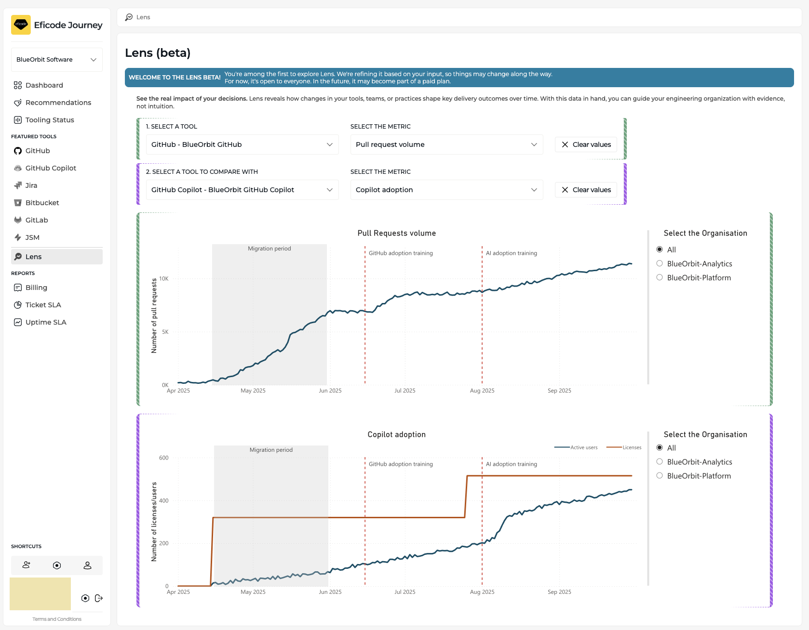
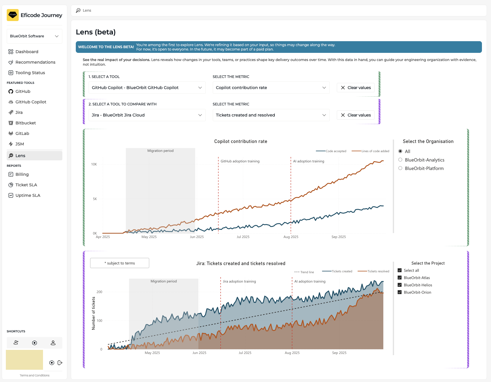

## In brief
{: #in-brief }

**The problem:** Cloud migrations reduced Eficode's visibility into customers' tools. At the same time, customers were investing in AI without a clear way to explore what it changed.

**My contribution:** I owned the customer problem, product direction, partner coordination, marketplace approval, and rollout. Engineering owned implementation. I worked with design, engineering, and pilot companies to refine the concept before expanding investment.

**A key decision:** Customer interviews moved Lens from a broad DevOps health focus toward customers' questions about AI's impact on delivery, security, and service outcomes. Another boundary was to gather useful metrics without collecting customer intellectual property or personal data.

**What changed:** Three marketplace connectors shipped across Atlassian and GitHub. Lens brought metrics from different tools onto a common timeline and became a capability supporting Eficode's advisory offering. Comparing trends helps investigate change; it does not establish causation on its own.

## The detail
{: #the-detail }

## Eficode
{: #eficode data-toc-skip='' .mt-4 .mb-0 }
- **Company:** Eficode is a B2B software and DevOps services company, providing expert consulting and managed services around DevOps, platform engineering, cloud, and enterprise service management, with strong partnerships and license management for major tool vendors (e.g., Atlassian, GitHub, GitLab, AWS, Microsoft).
- **Role:** Product Manager
- **Team:** 1 Product Manager, 1 Engineering Team Lead, 4 Software Engineers, 1 Product Designer, 1 Product Marketeer (shared)

---
### Product: Eficode Connectors
{: #product-eficode-connectors }

- **Users:** Eficode customers, Eficode employees
- **Time period:** November 2024 to now

#### Summary
{: #summary data-toc-skip='' .mt-4 .mb-0 }
Eficode Connectors are a set of plugins deployed in their respective tool vendors' cloud marketplaces. Their purpose, combined with Eficode's cloud architecture, is to capture metrics from customers' tool environments.
Thanks to the metrics gathered, Eficode can perform analyses for multiple use cases. The main use is found in combination with [Eficode Journey](/work/eficode-journey/#product-eficode-journey) to analyze the customer's platform engineering, IT and software engineering practices with their toolset and, with that information at hand, advise and support them in addressing discrepancies and helping the organization reach its goals. You'll find its use mostly in [Advanced Metrics](/work/eficode-journey/#3-advanced-metrics) and [Lens](#1-lens).
A second use is to give back the information to customers and the industry, in the form of reports on the state of DevOps, platform engineering and AI adoption in companies.
As of today, there are three connectors deployed: (1) Atlassian Cloud (Jira, Jira Service Management, and Confluence), (2) Atlassian Cloud Bitbucket, and (3) GitHub/GitHub Copilot (available for both Cloud and Data Center). Two more are in progress: GitLab (Data Center) and Azure. Many more are planned on the roadmap to support the Eficode customer base.

#### Outcomes
{: #outcomes data-toc-skip='' .mt-4 .mb-0 }
- Helped multiple organizations get more value out of their toolset.
- Led Eficode to new engagements with existing and new customers.
- Reinforced Eficode's relationships with its partners, especially with GitHub and Microsoft.
- Changed the way Eficode advises its customers towards a more tailored approach.

#### Customer value (Shared)
{: #customer-value-shared data-toc-skip='' .mt-4 .mb-0 }
Customers get a secure, vendor-native way to unlock cross-tool analytics without exposing intellectual property or personal data. Through Eficode Journey, they gain visibility into how their toolchain is used, where bottlenecks and risks are building up, and how initiatives (AI adoption, migrations, or process changes) impact outcomes over time. Customers reap most of the benefits when sitting with an Eficode advisor, who helps translate signals into concrete actions. The connectors are built to be complementary to each other, each covering at least one aspect of modern tool stacks: project management, software development pipelines, cloud orchestration, and more.

#### Capabilities built over time
{: #capabilities-built-over-time data-toc-skip='' .mt-4 .mb-0 }

##### 1) Eficode Connector for Jira Cloud, Confluence Cloud and Jira Service Management Cloud (JSM)
{: #1-eficode-connector-for-jira-cloud-confluence-cloud-and-jira-service-management-cloud-jsm data-toc-skip='' .mt-4 .mb-0 }
- **Introduced:** March 2025
- **Problem:** When an Eficode customer moves to Atlassian Cloud, Eficode loses the ability to extract analytics from the environment and, as a result, is impaired in its ability to advise.
- **What we shipped:** An Atlassian Plugin, living in the Atlassian marketplace, that gathers data from the customer environment to Eficode in a secure way, without compromising intellectual property (IP) or personal data (PII).
- **Eficode business value:** Analytics on Atlassian tools become possible, for a single organization as well as at scale for studying the market.
- **Connector focus:** Enables visibility over work throughput, operational load, and service-management hygiene, so that teams can target process bottlenecks and support effectiveness with evidence.

**Link:** <https://marketplace.atlassian.com/apps/1231800/eficode-connector-for-jira-and-confluence>

##### 2) Eficode Connector for GitHub and GitHub Copilot (Cloud and Data Center)
{: #2-eficode-connector-for-github-and-github-copilot-cloud-and-data-center data-toc-skip='' .mt-4 .mb-0 }
- **Introduced:** June 2025
- **Problem:** As organizations moved to GitHub Copilot, many wondered whether employees actually used it, what they used it for, and whether it affected the organization's bottom line. This is what we intended to solve.
- **What we shipped:** The GitHub plugin captures data about the customers' software pipelines without looking at the content of these pipelines. It also captures information about GitHub Copilot usage at the enterprise and organization levels. Again, we wanted to keep any IP or PII in the customer environment and focus on the "metadata". The plugin was launched both for Cloud and Data Center, as organizations were very active in both.
- **Eficode business value:** Analytics on GitHub and GitHub Copilot, for single organization purpose as well as at scale for studying the market. In an age where everyone is moving towards AI-assisted software development, this is extremely valuable information.
- **Connector focus:** Adds pipeline metrics, security signals (Dependabot and GitHub Advanced Security), and GitHub Copilot adoption signals so customers can evaluate whether AI changes outcomes, not just activity.

**Link (Cloud):** <https://github.com/marketplace/eficode-root-connector>
**Link (Data Center):** Not public

##### 3) Eficode Connector for Bitbucket Cloud
{: #3-eficode-connector-for-bitbucket-cloud data-toc-skip='' .mt-4 .mb-0 }
- **Introduced:** October 2025
- **Problem:** Multiple customers were using GitHub Copilot with Atlassian Bitbucket, so this became our next target to measure the impact of AI and transformation in customer organizations.
- **What we shipped:** The Bitbucket plugin captures information about customer pipelines in Bitbucket Cloud, with the intent to produce the same insights as the GitHub Connector.
- **Eficode business value:** Since Eficode has traditionally been a really strong Atlassian partner, a significant portion of the customer base has been users of Bitbucket. Offering the metrics we did for GitHub for these customers enabled better support and advisory from Eficode.
- **Connector focus:** Enables Copilot + Bitbucket cross-tool views for Atlassian-heavy organizations, enabling them to see the impact of GitHub Copilot on their software organization.

**Link:** <https://marketplace.atlassian.com/apps/2310380027/eficode-connector-for-bitbucket>

---

##### 1) Lens
{: #1-lens data-toc-skip='' .mt-4 .mb-0 }
- **Introduced:** November 2025
- **Problem:** [Advanced Metrics](/work/eficode-journey/#3-advanced-metrics) is focused on the present and doesn't show trendlines over time. This makes it difficult to see the impact of AI adoption or Eficode's work over time, and to understand when changes happen and what triggers them.
- **What we shipped:** This is probably the feature I'm most proud of. With the core product trio (PM, design, and engineering), we realized that by defining the x-axis as a specific unit of time, we could have multiple graphs displayed at the same time, regardless of the tool or the metric on the y-axis. This enabled us to build Lens, where one can, for example, see the impact of GitHub Copilot adoption in software teams on the amount of Jira epics closed (so more value reaches end customers, in an ideal case), and moments later look at how many security issues / UX issues it introduced, visible through GitHub security findings or Atlassian Service Desk bugs.
- **Eficode business value:** The business potential of this feature is enormous. It is built to support most of Eficode's business (Consulting, License, Managed Services) and could bring a change to the whole consulting market, where customers expect such metrics to be in place to ensure impact. Unfortunately, the timing was a bit off, as Eficode is having a really large organization overhaul (ongoing still as of January 2026), and the organization didn't have the bandwidth for me to run go-to-market activities with the Product Marketing Manager, so the reach stayed limited to my close network. The adoption of that close network has been fast and strong though, and it really landed when they presented it to their customers, leading to multiple new engagements for Eficode.
- **Customer value:** For the customer that enjoyed the feature, this is transformational. They now can directly see the impact of Eficode and their AI adoption (or any other transformation) over time. This led to quite a few “wow” moments with customers when they discovered their graphs.

  
  

